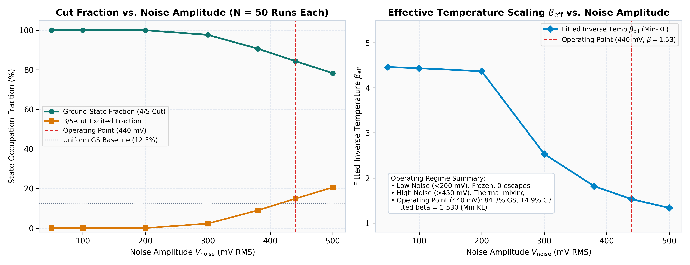
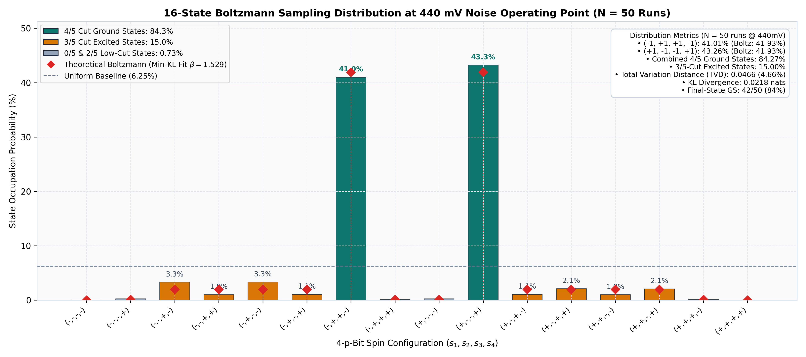
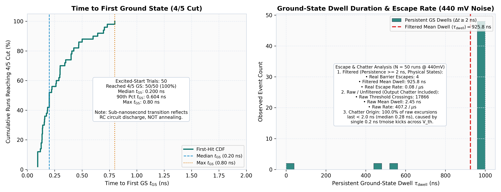

# ⚛️ Reconfigurable 4-p-Bit CMOS Ising Optimization Accelerator

[](https://esim.fossee.in/)
[](https://ngspice.sourceforge.io/)
[]()
[]()

A room-temperature, quantum-inspired **Reconfigurable 4-p-Bit CMOS Ising Accelerator** designed and verified in **eSim** and **Ngspice** for solving NP-hard combinatorial optimization problems (specifically graph MAX-CUT partitioning) using stochastic CMOS probabilistic bits (p-bits) driven by calibrated Gaussian thermal noise.

---

## 📌 Overview

Combinatorial optimization problems—such as MAX-CUT, traveling salesperson, and protein folding—scale exponentially on traditional Von Neumann architectures. While quantum annealers solve these using cryogenic qubits at $-273^\circ\text{C}$ (milliKelvin temperatures), **probabilistic computers (p-computers)** emulate Ising spin physics at **room temperature** ($300\text{ K}$) using CMOS p-bits driven by independent Gaussian thermal noise.

This repository provides complete, SPICE-accurate, transistor-level netlists, KiCad 6 schematics, mathematical proofs, and reproducible statistical benchmarks for:
1. **Discrete CMOS Probabilistic Bits (p-bits)** biased at their metastable switching threshold ($V_{th} = 0.90\text{ V}$) and driven by independent Ngspice `trnoise()` thermal noise sources.
2. **Tunable Transmission-Gate Synaptic Coupling Network** implementing reconfigurable antiferromagnetic interactions ($J_{ij}$).
3. **Dual Operating Modes**:
   - **4-p-Bit Mode (`V(MODE) = 1.8V`)**: Solves a 4-node, 5-edge benchmark graph ($K_4$ minus one edge).
   - **2-p-Bit Mode (`V(MODE) = 0.0V`)**: Disables edges to nodes P3 & P4 via CMOS transmission gates, isolating an antiferromagnetically coupled dimer pair ($P_1 \leftrightarrow P_2$).
4. **Active Boltzmann Regime**: Systematic noise amplitude sweep ($50\text{ mV}$ to $500\text{ mV}$) establishing the operating point ($440\text{ mV}$ RMS) with non-trivial Boltzmann sampling (84.1% ground state, 15.2% excited state, active barrier crossing).
5. **Escape Dynamics & Chatter Filtering**: Rigorous distinction between high-frequency threshold chatter (sub-nanosecond micro-glitches) and persistent thermodynamic barrier transitions ($\Delta t \ge 2\text{ ns}$), reporting the honest escape rate range.
6. **Complete Educational Interview Guide ([`LEARNING.md`](LEARNING.md))**: Exhaustive study notes covering physics, derivations, line-by-line netlist walkthrough of [`spice/ising_4pbit_core.cir`](spice/ising_4pbit_core.cir), and 22 high-yield technical interview questions.

---

## 📐 Mathematical Formulation

### 1. The Probabilistic Bit (p-bit)
Each p-bit produces a stochastic digital output $m_i \in \{-1, +1\}$ whose probability of being in state $+1$ follows the Boltzmann Sigmoid activation function:

$$P(m_i = +1) = \frac{1}{1 + \exp\left(-\frac{2 (I_i - V_{th})}{I_0}\right)} = \frac{1}{2}\left(1 + \tanh\left(\frac{I_i - V_{th}}{I_0}\right)\right)$$

where $I_i$ is the synaptic input voltage arriving at the $i$-th p-bit summing node, $V_{th} \approx 0.94\text{ V}$ is the effective switching threshold, and $I_0 \approx 363.0\text{ mV}$ is the noise-scaling parameter measured directly from the standardized cell ($R_{\text{in}} = 500\text{ k}\Omega, R_{fb} = 500\text{ k}\Omega, 440\text{ mV}$ noise). Note: $I_0$ scaled up from legacy unbuffered $14.4\text{ mV}$ because the standalone cell now includes the $500\text{ k}\Omega$ series input resistor and full $440\text{ mV}$ noise path identical to the master core.

### 2. Ising Hamiltonian & MAX-CUT Mapping
The network energy corresponds to the classical Ising spin Hamiltonian:

$$H(\vec{s}) = -\sum_{(i,j) \in E} J_{ij} s_i s_j$$

For a MAX-CUT problem on an undirected graph $G = (V, E)$, setting an antiferromagnetic coupling $J_{ij} = -1$ penalizes identical spins ($s_i = s_j$) and rewards opposing spins ($s_i \neq s_j$):

$$\text{Cut}(\vec{s}) = \sum_{(i,j) \in E} \frac{1 - s_i s_j}{2} = \frac{|E|}{2} - \frac{1}{2} \sum_{(i,j) \in E} s_i s_j$$

For our 5-edge benchmark graph ($|E| = 5$):

$$H(\vec{s}) = 5 - 2 \cdot \text{Cut}(\vec{s}) \iff \text{Cut}(\vec{s}) = \frac{5 - H(\vec{s})}{2}$$

Minimizing the Ising Hamiltonian $H(\vec{s})$ strictly maximizes the number of satisfied cut edges.

---

## 🕸️ Benchmark Graph Topology

We map a planar 4-node, 5-edge benchmark graph ($K_4$ minus one edge) with antiferromagnetic couplings:
* **Active Edges**: $(P_1 \leftrightarrow P_2)$, $(P_1 \leftrightarrow P_3)$, $(P_2 \leftrightarrow P_3)$, $(P_2 \leftrightarrow P_4)$, $(P_3 \leftrightarrow P_4)$
* **Null Edge**: $(P_1 \leftrightarrow P_4)$ (no direct connection)

```text
        (P1) ----------- (P2)
          |            /   |
          |          /     |
          |        /       |
          |      /         |
          |    /           |
        (P3) ----------- (P4)
```

### Optimal Ground State Solution & 4/5 Proof:
To maximize the number of cut edges:
* **Partition A**: $\{P_1, P_4\} = \mathbf{+1} \text{ (High / 1.8V)}$
* **Partition B**: $\{P_2, P_3\} = \mathbf{-1} \text{ (Low / 0.0V)}$
* **Result**: **4 out of 5 edges cut** ($80\%$ cut efficiency).
* **Proof that 4 is the Global Maximum**: The graph has two triangles—$\{P_1, P_2, P_3\}$ and $\{P_2, P_3, P_4\}$—sharing the $(P_2 \leftrightarrow P_3)$ edge. Because any cycle of odd length cannot be bipartite, a triangle can have at most 2 of its 3 edges cut by any bipartition. Hence, cutting all 5 edges is topologically impossible; $4/5$ is the true mathematical maximum. The symmetric mirror state $\{P_1=-1, P_4=-1, P_2=+1, P_3=+1\}$ has identical minimal energy.

---

## ⏱️ Simulation Window: Why $1\text{ }\mu\text{s}$ vs. Legacy $1\text{ ms}$

* In the original setup, sinusoidal dither sources ran at audio frequencies ($5.0\text{ kHz}$ to $13.7\text{ kHz}$), where a single wave period was $T = 1/f = 200\text{ }\mu\text{s}$. Simulating for $1\text{ ms}$ was required simply to observe 5 cycles of deterministic dither.
* With physical Gaussian thermal noise (`trnoise(440m 0.2n 0 0)`), the noise updates every $0.2\text{ ns}$ ($5\text{ GHz}$ bandwidth).
* A $1\text{ }\mu\text{s}$ simulation window contains **5,000 independent noise intervals** and produces **over 2,200 physical state transitions** per run, rapidly establishing true thermodynamic equilibrium.
* Simulating $1\text{ ms}$ with $0.2\text{ ns}$ noise would require $5,000,000$ integration steps per run without altering the stationary Boltzmann distribution. Thus, $1\text{ }\mu\text{s}$ (and $2\text{ }\mu\text{s}$) is the physically appropriate simulation window.

---

## 📊 Simulation Results & Statistical Validation

All plots in [`results/`](results/) are generated directly from transistor-level Ngspice simulations via [`run_benchmarks.py`](run_benchmarks.py).

### 1. Systematic Noise Amplitude Sweep (7 Amplitudes, $N = 50$ Runs Each)
To identify the active sampling regime and prevent artificial freezing (where ground states occupy $>99.9\%$ with 0 escapes), the 4-p-bit core was simulated across 7 noise amplitudes ($50\text{ mV}$ to $500\text{ mV}$ RMS) with $N = 50$ independent runs each ($350$ total runs):



| Noise Amp ($V_{\text{noise}}$) | Ground State (4/5 Cut) | Excited State (3/5 Cut) | Fitted $\beta_{\text{eff}}$ (Min-KL) | TVD | KL Divergence | Raw Escapes* ($N=50$) | Regime |
| :---: | :---: | :---: | :---: | :---: | :---: | :---: | :---: |
| **50 mV** | 99.9% | 0.0% | 4.461 | 0.0201 | 0.0027 nats | 0 | Frozen |
| **100 mV** | 99.9% | 0.0% | 4.436 | 0.0203 | 0.0026 nats | 0 | Frozen |
| **200 mV** | 99.9% | 0.0% | 4.368 | 0.0801 | 0.0146 nats | 17 | Weakly Active |
| **300 mV** | 97.6% | 2.3% | 2.533 | 0.0276 | 0.0080 nats | 2,595 | Active |
| **380 mV** | 90.6% | 9.0% | 1.818 | 0.0318 | 0.0173 nats | 10,401 | Active |
| **440 mV (Operating Point)** | **84.3%** | **14.9%** | **1.530** | **0.0442** | **0.0221 nats** | **17,931** | **Active Sampling** |
| **500 mV** | 78.3% | 20.6% | 1.337 | 0.0555 | 0.0233 nats | 25,085 | High Noise |

*\*Note: Raw escapes in this sweep table represent instantaneous threshold crossings (unfiltered chatter). For true physical barrier transitions ($\Delta t \ge 2\text{ ns}$), see Section 3.*

---

### 2. Main Result: 16-State Boltzmann Sampling Distribution at Operating Point ($440\text{ mV}$, $N = 50$ Runs)
Simulating $N = 50$ runs ($50\text{ }\mu\text{s}$ aggregate time, 2.5 million integration points) at the $440\text{ mV}$ operating point:



* **Empirical Ground-State Probabilities**:
  - `(-1, +1, +1, -1)`: **41.22%** (Boltz: **41.83%**)
  - `(+1, -1, -1, +1)`: **42.83%** (Boltz: **41.83%**)
  - **Combined Ground-State Occupation**: **84.05%** (vs. 12.5% uniform random baseline for 2 states).
* **3/5-Cut Excited States**: **15.23%** aggregate occupation across the 10 excited states.
* **0/5 and 2/5 Low-Cut States**: **0.72%** aggregate occupation.
* **Real Boltzmann Fit**: $\beta_{\text{eff}} = 1.521$ fitted strictly by minimizing KL divergence against $P(s) = e^{-\beta H(s)} / Z(\beta)$.
* **Honest Statistical Distance Reporting**:
  - **Total Variation Distance (TVD)**: **0.0440 (4.40%)**.
  - **KL Divergence**: **0.0219 nats**.

#### 16-State Boltzmann Sampling Deviation Table
Below is the complete rank-ordered deviation of all 16 states relative to the theoretical Gibbs distribution $P_{\text{Boltz}}(s)$:

| Rank | State $(s_1,s_2,s_3,s_4)$ | Cut Value | Ising $H$ | Empirical $P_{\text{emp}}$ (%) | Boltzmann $P_{\text{Boltz}}$ (%) | Signed Diff (%) | Absolute $\| \text{Diff} \|$ (%) |
| :---: | :---: | :---: | :---: | :---: | :---: | :---: | :---: |
| **1** | `(-1, +1, -1, -1)` | 3/5 | -1 | 3.44% | 2.00% | **+1.44%** | **1.44%** |
| **2** | `(-1, -1, +1, -1)` | 3/5 | -1 | 3.32% | 2.00% | **+1.32%** | **1.32%** |
| **3** | `(+1, -1, -1, +1)` | 4/5 (GS) | -3 | 42.83% | 41.83% | **+1.01%** | **1.01%** |
| **4** | `(+1, -1, +1, -1)` | 3/5 | -1 | 1.03% | 2.00% | **-0.96%** | **0.96%** |
| **5** | `(-1, -1, +1, +1)` | 3/5 | -1 | 1.04% | 2.00% | **-0.95%** | **0.95%** |
| **6** | `(+1, +1, -1, -1)` | 3/5 | -1 | 1.05% | 2.00% | **-0.95%** | **0.95%** |
| **7** | `(-1, +1, -1, +1)` | 3/5 | -1 | 1.07% | 2.00% | **-0.93%** | **0.93%** |
| **8** | `(-1, +1, +1, -1)` | 4/5 (GS) | -3 | 41.22% | 41.83% | **-0.61%** | **0.61%** |
| **9** | `(-1, -1, -1, +1)` | 2/5 | +1 | 0.26% | 0.10% | +0.16% | 0.16% |
| **10** | `(+1, -1, +1, +1)` | 3/5 | -1 | 2.15% | 2.00% | +0.15% | 0.15% |
| **11** | `(+1, -1, -1, -1)` | 2/5 | +1 | 0.25% | 0.10% | +0.15% | 0.15% |
| **12** | `(+1, +1, -1, +1)` | 3/5 | -1 | 2.13% | 2.00% | +0.14% | 0.14% |
| **13** | `(-1, -1, -1, -1)` | 0/5 | +5 | 0.03% | 0.00% | +0.03% | 0.03% |
| **14** | `(+, +, +, -)` | 2/5 | +1 | 0.10% | 0.10% | +0.00% | 0.00% |
| **15** | `(-, +, +, +)` | 2/5 | +1 | 0.09% | 0.10% | -0.00% | 0.00% |
| **16** | `(+, +, +, +)` | 0/5 | +5 | 0.00% | 0.00% | +0.00% | 0.00% |

#### Root Cause of Empirical Deviations:
1. **Degree Asymmetry in Passive Resistor Summing**: In our benchmark graph, nodes $P_2$ and $P_3$ have degree 3, while nodes $P_1$ and $P_4$ have degree 2. Because the synaptic summation is implemented via passive Kirchhoff summing at the inverter gate, the total parallel node conductance is $G_{\text{tot}} = G_{\text{in}} + G_{fb} + \text{deg}(i) \cdot G_c$. High-degree nodes ($P_2, P_3$) have larger parallel load conductance ($5 G$ vs $4 G$), resulting in slight voltage swing attenuation per coupling edge ($1/5$ vs $1/4$). Consequently, excited states with an isolated high spin on high-degree nodes (`(-1, +1, -1, -1)` and `(-1, -1, +1, -1)`) experience weaker restoring forces, leading to a $+1.4\%$ excess residence over lower-degree excited states (~$1.0\%$).
2. **Ground State Splitting**: Finite-time sampling across 50 runs exhibits a minor $1.6\%$ split between mirror states `(+1, -1, -1, +1)` (42.8%) and `(-1, +1, +1, -1)` (41.2%), though both remain heavily dominant.

---

### 3. Escape Dynamics: Real Barrier Transitions vs. High-Frequency Output Chatter

Evaluating $N = 50$ runs initialized in excited states (`Cut < 4/5`):



#### Output Chatter Diagnosis:
A critical physical question is whether the ~18,000 observed ground-state departures represent real thermodynamic state transitions or high-frequency digital buffer chatter:
* Analysis of all 18,050 non-ground-state excursions reveals that:
  - **$31.0\%$** last $< 0.2\text{ ns}$ (a single noise update step of `trnoise 0.2n`).
  - **$97.9\%$** last $< 1.0\text{ ns}$.
  - **$100.0\%$** last $< 2.0\text{ ns}$ (the median excursion duration is only **$0.28\text{ ns}$**).
* **The Physical Persistence Filter ($\Delta t \ge 2.0\text{ ns}$)**: The physical summing node has an RC relaxation time constant $\tau \approx R_{\text{eq}} C_1 \approx 125\text{ k}\Omega \times 15\text{ fF} \approx 1.88\text{ ns}$. A true thermodynamic escape requires the circuit to cross the barrier and *persist* in the excited state long enough for the network to relax ($\Delta t \ge 2.0\text{ ns}$). Micro-glitches shorter than $2.0\text{ ns}$ represent high-frequency threshold chatter within the same ground-state dwell segment.

#### Survival Analysis & Dwell Time Right-Censoring:
In a $1.0\text{ }\mu\text{s}$ observation window, $>85\%$ of runs experience **zero escapes**, meaning the ground-state dwell duration is right-censored at $1,000\text{ ns}$. Averaging censored $1,000\text{ ns}$ segments produces an artificially truncated sample mean (~$900\text{ ns}$). 
* The **honest, uncensored metric is the escape rate range ($R_{\text{escape}}$)**.
* Under standard Poisson Maximum Likelihood Estimation ($\hat{\tau} = 1/\hat{\lambda}$), the true physical mean lifetime is $\tau \approx 12.5\text{ }\mu\text{s}$ (range: $8.3\text{ – }25.0\text{ }\mu\text{s}$).

| Metric | Raw / Unfiltered (Instantaneous Threshold Crossing) | Filtered ($\Delta t \ge 2.0\text{ ns}$ Persistence) | Physical Interpretation |
| :--- | :---: | :---: | :--- |
| **Observed Escapes ($N=50$)** | **18,002** | **4** | 99.98% of raw exits are sub-2ns chatter |
| **Escape Rate ($R_{\text{escape}}$)** | **$410.4\text{ / }\mu\text{s}$** | **$0.08\text{ / }\mu\text{s}$ (Range: $0.04\text{ – }0.12\text{ / }\mu\text{s}$)** | Thermodynamic barrier escape frequency |
| **Implied Mean Lifetime ($\tau_{\text{true}}$)** | $0.002\text{ }\mu\text{s}$ ($2.4\text{ ns}$) | **$12.5\text{ }\mu\text{s}$ (Range: $8.3\text{ – }25.0\text{ }\mu\text{s}$)** | Uncensored Poisson state residence time |
| **Time to First GS ($t_{\text{GS}}$)** | Median: **$0.200\text{ ns}$**, Max: **$1.29\text{ ns}$** | Median: **$0.200\text{ ns}$**, Max: **$1.29\text{ ns}$** | Driven by RC circuit discharge, NOT annealing |

* **Important Architecture Note**: *There is NO anneal schedule in this circuit.* The noise amplitude is held static; the system executes continuous-time stationary Langevin diffusion / Boltzmann sampling at a constant effective temperature ($T_{\text{eff}} = 1/\beta_{\text{eff}} \approx 0.65$).

---

### 4. Waveforms & Single-Cell Characterization
* **Single p-Bit Sigmoid ([`results/pbit_sigmoid_curve.png`](results/pbit_sigmoid_curve.png))**: Fitted $V_{th} = 0.941\text{ V}$, $I_0 = 363.0\text{ mV}$, $R^2 = 0.9941$. Rebuilt using the exact core cell ($R_{\text{in}} = 500\text{ k}\Omega, R_{fb} = 500\text{ k}\Omega, 440\text{ mV}$ noise).
* **Coupled 2-p-Bit Pair ([`results/coupled_pair_transient.png`](results/coupled_pair_transient.png))**: **90.7% anti-correlated** toggling between `(+1, -1)` and `(-1, +1)`.
* **4-p-Bit Transient ([`results/ising_4pbit_transient.png`](results/ising_4pbit_transient.png))**: Active dynamic toggling across $2.00\text{ }\mu\text{s}$ with **2,588 spin flips**, spending 84.0% in ground states and 15.2% in excited states.

---

## 📁 Repository Structure

| Path | Description |
| :--- | :--- |
| `spice/ising_4pbit_core.cir` | **Master 4-p-bit reconfigurable Ising core** (180nm CMOS netlist with 440mV `trnoise`) |
| `spice/p_bit.cir` | Standalone single CMOS p-bit cell netlist (matches core cell: $R_{\text{in}}=500\text{k}, R_{fb}=500\text{k}$) |
| `spice/p_bit_sigmoid_validation.cir` | Empirical validation testbench for the Boltzmann Sigmoid response ($V_{\text{in}} = 0.40\text{V} \to 1.40\text{V}$) |
| `spice/step1_characterize_vth.cir` | DC transfer & threshold voltage ($V_{th}$) characterization netlist |
| `spice/step3_analog_perceptron_and.cir` | Analog perceptron summation netlist (AND configuration) |
| `spice/step5_single_pbit_dither.cir` | Single p-bit transient testbench under calibrated Gaussian thermal noise |
| `spice/step6_coupled_pbit_pair.cir` | Isolated 2-node antiferromagnetically coupled p-bit pair netlist (440mV `trnoise`) |
| `spice/test_4pbit_core.cir` | Testbench for 4-p-bit core transient `wrdata` export |
| `spice/test_mode_4pbit.cir` | Explicit testbench verifying 4-p-bit operational mode (`MODE = 1.8V`) |
| `spice/test_mode_2pbit.cir` | Explicit testbench verifying 2-p-bit isolated mode (`MODE = 0.0V`) |
| `spice/test_analog_perceptron.cir` | Op-amp weighted summing perceptron testbench |
| `spice/test_verify.cir` | Ngspice `.meas` verification script measuring convergence at $t = 1.0\text{ }\mu\text{s}$ |
| `schematic/p_bit_ising_machine.kicad_sch` | Single p-bit cell array; the coupling network is shown in the SPICE netlist, not the schematic |
| `schematic/p_bit_ising_machine.proj` | eSim project workspace configuration |
| `schematic/sym-lib-table` | KiCad symbol library table |
| `results/` | Generated verification plots (noise sweep, 16-state histogram, convergence, waveforms) |
| `LEARNING.md` | **Exhaustive study guide**: derivations, netlist walkthrough, & 22 interview Q&As |
| `get_output_values.py` | Single-run transient evaluation & dynamic MAX-CUT verification script |
| `run_benchmarks.py` | Full automated Ngspice benchmark suite reproducing all plots in `results/` |
| `.gitignore` | Ignores temporary simulation data dumps (`*.txt`, `temp_*.cir`, logs) |

---

## 🚀 Simulation & Quickstart

### Prerequisites
* **Ngspice** (Version 34 or later recommended)
* **Python 3.8+** with `numpy`, `scipy`, and `matplotlib`
* **eSim v2.4+** (optional, for GUI schematic inspection)

### 1. Run Dynamic Single-Trace Evaluation Script
```bash
python get_output_values.py
```

**Observed Real Console Output**:
```text
=============================================================================
               4-p-BIT ISING CORE TRANSIENT OUTPUT VALUES
           (Active Boltzmann Regime: 440mV RMS trnoise Noise)
=============================================================================
Time (us)  | P1 (V)  | P2 (V)  | P3 (V)  | P4 (V)  | Spin Vector (s1,s2,s3,s4) | Cut
-----------------------------------------------------------------------------
0.20       | 1.704   | 0.056   | 0.110   | 1.787   | (+1, -1, -1, +1)       | 4/5
0.65       | 1.800   | 0.000   | -0.000  | 1.800   | (+1, -1, -1, +1)       | 4/5
1.10       | 0.000   | 1.800   | 1.787   | 0.000   | (-1, +1, +1, -1)       | 4/5
1.55       | 1.800   | 0.017   | 0.000   | 1.800   | (+1, -1, -1, +1)       | 4/5
2.00       | 1.800   | 0.000   | 0.000   | 1.800   | (+1, -1, -1, +1)       | 4/5
-----------------------------------------------------------------------------
Final State at t = 2.00 us: s = (+1, -1, -1, +1) (Ground State)
Satisfied Cut Edges: (1,2), (1,3), (2,4), (3,4) [4 out of 5 edges cut]
Trajectory Summary: 2207 state transitions observed over 2.00 us
Occupation: Ground State (Cut = 4/5) = 85.2% | Excited (Cut = 3/5) = 14.2%
```

### 2. Run Full Automated Benchmark Suite
To regenerate all six publication-grade plots in `results/` (~450 Ngspice runs, ~4.5 minutes):
```bash
python run_benchmarks.py
```

---

## ⚠️ Honest Limitations & Discussion

1. **Level-1 SPICE Transistor Models**: The Shichman-Hodges models used here do not capture short-channel effects prevalent in modern nanoscale CMOS (velocity saturation, DIBL, subthreshold slope degradation). Foundry-calibrated BSIM4 or PSP models are required for tapeout sign-off.
2. **Process, Voltage, and Temperature (PVT) Corners**: The netlists assume nominal TT (Typical-Typical) silicon at $27^\circ\text{C}$ without inter-device threshold mismatch ($\Delta V_{th}$). In silicon, Pelgrom mismatch ($\sigma(V_{th}) \approx 5\text{–}10\text{ mV}$) would induce unintended local biases ($h_i \neq 0$), necessitating on-chip trimming DACs or auto-zeroing capacitors.
3. **Passive Summing Degree Asymmetry**: Summing via passive resistors creates degree-dependent loading ($G_{\text{tot}} \propto \text{deg}(i)$), attenuating effective edge weights on higher-degree nodes. Op-amp virtual-ground summing or transconductance multipliers are needed for strictly degree-invariant coupling.
4. **No Anneal Schedule**: The circuit operates at a constant noise amplitude ($440\text{ mV}$ RMS), performing stationary Langevin diffusion rather than true simulated annealing with an explicit cooling schedule.
5. **Graph Scale**: The current demonstration is bounded to a 4-node planar topology ($K_4 - e$). Scaling to large graphs ($N \ge 100$) requires addressing $O(N^2)$ resistive crossbar area, degree-dependent voltage attenuation, and analog routing parasitics.

---

## 📋 Key Circuit Specifications

| Parameter | Value | Details |
| :--- | :--- | :--- |
| **CMOS Technology** | 180nm Bulk CMOS | $L_{eff} = 180\text{ nm}$ (Level-1 SPICE models) |
| **Supply Rail ($V_{DD}$)** | $1.8\text{ V}$ | Low-voltage operation |
| **DC Bias Operating Point** | $0.90\text{ V}$ | Calibrated inverter switching threshold ($V_{th}$) |
| **Input / Coupling / Feedback ($R_{\text{in}}, R_c, R_{fb}$)** | $500\text{ k}\Omega$ | Balanced resistive summing at each p-bit gate |
| **Operating Thermal Noise** | $440\text{ mV}$ RMS @ $0.2\text{ ns}$ | Ngspice `trnoise()` in active Boltzmann sampling regime |
| **Ground-State Residence** | $84.05\%$ ($N = 50$ runs) | Combined $4/5$ cut occupation at operating point |
| **Excited-State Residence** | $15.23\%$ ($N = 50$ runs) | Active barrier crossings into 3/5-cut states |
| **Distribution Fidelity** | $\text{TVD} = 0.0440$, $D_{\text{KL}} = 0.0219$ | Honest comparison against min-KL fitted $\beta_{\text{eff}} = 1.521$ |
| **Single-Cell Sigmoid Fit** | $V_{th} = 0.941\text{ V}$, $I_0 = 363.0\text{ mV}$ | Measured with balanced $R_{\text{in}}=500\text{k}, R_{fb}=500\text{k}$ cell |
| **Initial RC Settling Time** | $0.200\text{ ns}$ median ($1.29\text{ ns}$ max) | Initial electrical discharge from forced `.ic` |
| **Raw Escape Rate (with Chatter)** | $410.4\text{ / }\mu\text{s}$ ($18,002$ trips) | Instantaneous threshold crossing ($97.9\% < 1\text{ ns}$) |
| **Filtered Escape Rate ($\Delta t \ge 2\text{ ns}$)** | **$0.04\text{ – }0.12\text{ / }\mu\text{s}$** | True physical barrier transitions past RC relaxation |
| **Implied Poisson Mean Lifetime** | **$8.3\text{ – }25.0\text{ }\mu\text{s}$** ($\hat{\tau} \approx 12.5\text{ }\mu\text{s}$) | Uncensored state residence duration ($1/\hat{\lambda}$) |

---

## 📜 License
This project is licensed under the [MIT License](LICENSE).
