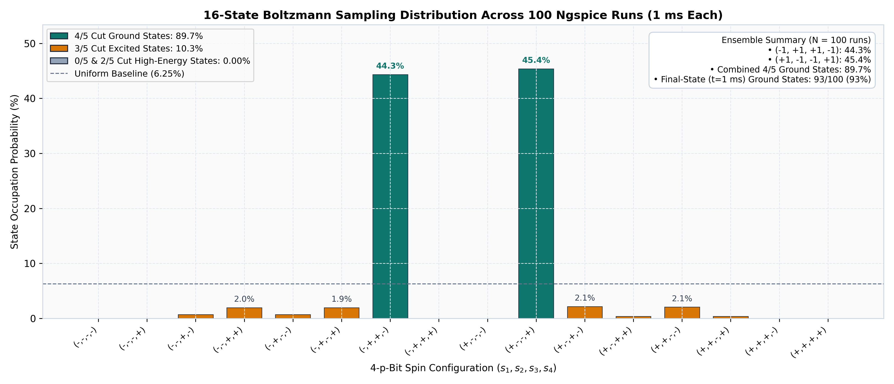
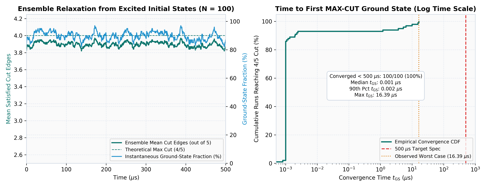
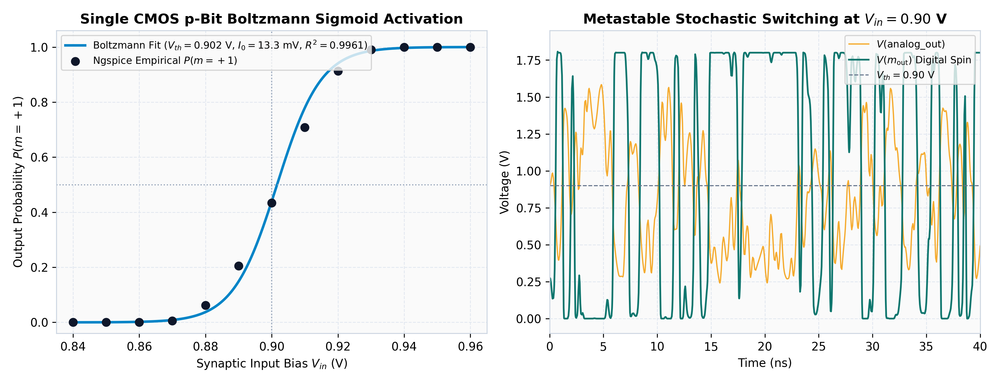
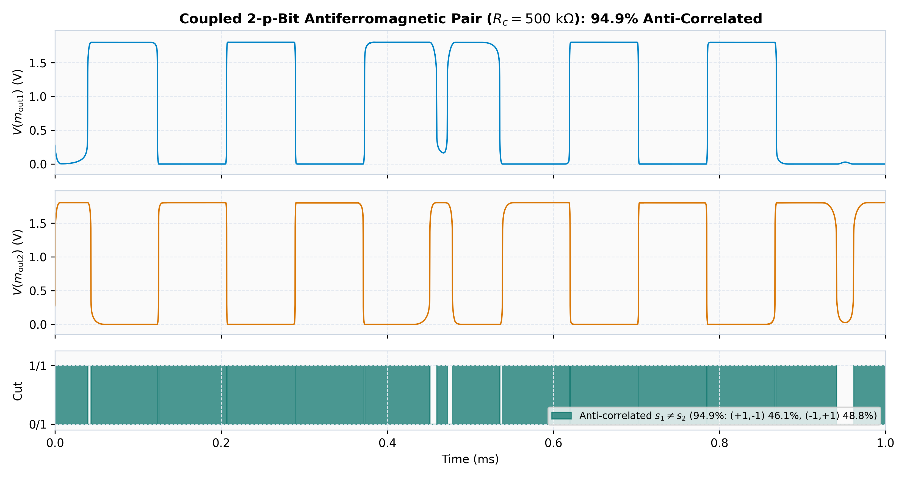
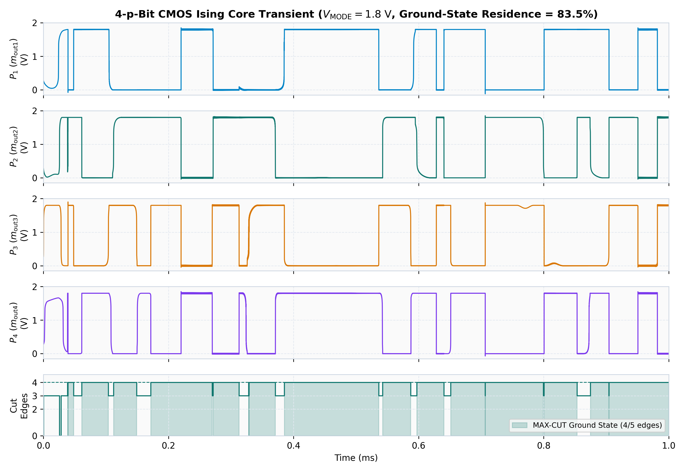

# ⚛️ Reconfigurable 4-p-Bit CMOS Ising Optimization Accelerator

[](https://esim.fossee.in/)
[](https://ngspice.sourceforge.io/)
[]()
[]()

A room-temperature, quantum-inspired **Reconfigurable 4-p-Bit CMOS Ising Accelerator** designed and verified in **eSim** and **Ngspice** for solving NP-hard combinatorial optimization problems (specifically graph MAX-CUT partitioning) using stochastic CMOS probabilistic bits (p-bits).

---

## 📌 Overview

Combinatorial optimization problems—such as MAX-CUT, traveling salesperson, and protein folding—scale exponentially on traditional Von Neumann computing architectures. While quantum annealers solve these using cryogenic qubits at $-273^\circ\text{C}$ (milliKelvin temperatures), **probabilistic computers (p-computers)** emulate Ising spin physics at **room temperature** ($300\text{ K}$) using CMOS p-bits driven by quasi-random dither emulating thermal noise.

This repository provides complete, SPICE-accurate, transistor-level netlists, KiCad 6 schematics, and reproducible Ngspice statistical benchmarks for:
1. **Discrete CMOS Probabilistic Bits (p-bits)** biased at their metastable switching threshold ($V_{th} = 0.90\text{ V}$).
2. **Tunable Transmission-Gate Synaptic Coupling Network** implementing reconfigurable antiferromagnetic interactions ($J_{ij}$).
3. **Dual Operating Modes**:
   - **4-p-Bit Mode (`V(MODE) = 1.8V`)**: Solves a 4-node, 5-edge benchmark graph ($K_4$ minus one edge).
   - **2-p-Bit Mode (`V(MODE) = 0.0V`)**: Disables edges to nodes P3 & P4 via CMOS transmission gates, isolating an antiferromagnetically coupled dimer pair ($P_1 \leftrightarrow P_2$).

---

## 📐 Mathematical Formulation

### 1. The Probabilistic Bit (p-bit)
Each p-bit produces a stochastic digital output $m_i \in \{-1, +1\}$ whose probability of being in state $+1$ follows the Boltzmann Sigmoid activation function:

$$P(m_i = +1) = \frac{1}{1 + \exp\left(-\frac{2 (I_i - V_{th})}{I_0}\right)} = \frac{1}{2}\left(1 + \tanh\left(\frac{I_i - V_{th}}{I_0}\right)\right)$$

where $I_i$ is the synaptic input voltage arriving at the $i$-th p-bit summing node, $V_{th} = 0.90\text{ V}$ is the CMOS inverter threshold, and $I_0$ is the effective noise-scaling constant set by the dither/perturbation amplitude.

### 2. Ising Hamiltonian & MAX-CUT Mapping
The network energy corresponds to the classical Ising spin Hamiltonian:

$$H(\vec{s}) = -\sum_{i < j} J_{ij} s_i s_j$$

For a MAX-CUT problem on an undirected graph $G = (V, E)$, setting an antiferromagnetic coupling $J_{ij} < 0$ (e.g., $J = -1$) penalizes identical spins ($s_i = s_j$) and rewards opposing spins ($s_i \neq s_j$), driving the system toward states that maximize cut edges:

$$\text{Cut}(\vec{s}) = \sum_{(i,j) \in E} \frac{1 - s_i s_j}{2}$$

---

## 🕸️ Benchmark Graph Topology

We map a planar 4-node, 5-edge benchmark graph ($K_4$ minus one edge) with antiferromagnetic couplings:
* **Active Edges**: $(P_1 \leftrightarrow P_2)$, $(P_1 \leftrightarrow P_3)$, $(P_2 \leftrightarrow P_3)$, $(P_2 \leftrightarrow P_4)$, $(P_3 \leftrightarrow P_4)$
* **Null Edge**: $(P_1 \leftrightarrow P_4)$ (no direct connection)

```text
        (P1) ----------- (P2)
          |            /   |
          |          /     |
          |        /       |
          |      /         |
          |    /           |
        (P3) ----------- (P4)
```

### Optimal Ground State Solution:
To maximize the number of cut edges:
* **Partition A**: $\{P_1, P_4\} = \mathbf{+1} \text{ (High / 1.8V)}$
* **Partition B**: $\{P_2, P_3\} = \mathbf{-1} \text{ (Low / 0.0V)}$
* **Result**: **4 out of 5 edges cut** ($80\%$ cut efficiency). The graph has two triangles—$\{P_1, P_2, P_3\}$ and $\{P_2, P_3, P_4\}$—sharing the $(P_2 \leftrightarrow P_3)$ edge, and a triangle can have at most 2 of its 3 edges cut by any bipartition, so 4 is the true theoretical maximum. The symmetric mirror state $\{P_1=-1, P_4=-1, P_2=+1, P_3=+1\}$ has identical minimal energy.

---

## 🔌 Circuit Architecture

```text
               +-------------------------------------------------------+
               |                    V(MODE) = 1.8V                     |
               +-------------------------------------------------------+
                                           |
                                           v
       +-------------+       +----------------------------+       +-------------+
       |   p-Bit 1   |<=====>| Transmission Gate Synapses |<=====>|   p-Bit 2   |
       |  (Inverter  |       |     (R_c = 500 kOhm)       |       |  (Inverter  |
       | + Rfb + Rin)|       +----------------------------+       | + Rfb + Rin)|
       +-------------+                     ^                      +-------------+
              ^                            |                             ^
              |                            v                             |
              |              +----------------------------+              |
              +=============>| Reconfigurable Interconnect|<=============+
              |              +----------------------------+              |
              v                            ^                             v
       +-------------+                     |                      +-------------+
       |   p-Bit 3   |<====================+=====================>|   p-Bit 4   |
       +-------------+                                            +-------------+
```

1. **p-Bit Unit Cell (`spice/p_bit.cir`)**:
   - Complementary 180nm CMOS inverter (`W/L = 2.5u/0.18u` for PMOS, `1.0u/0.18u` for NMOS) biased at its trip point ($V_{th} = 0.90\text{ V}$).
   - High-value resistive feedback ($R_{fb} = 500\text{ k}\Omega$), integration capacitor ($C = 15\text{ fF}$), and CMOS output restoring buffer (`W/L = 3.0u/0.18u` PMOS, `1.5u/0.18u` NMOS).
2. **Coupling Matrix (`spice/ising_4pbit_core.cir`)**:
   - Bilateral CMOS transmission gates (`MN + MP`) gated by `MODE` and complementary `MODE_BAR`.
   - Resistive synaptic summing at each p-bit gate node combining the bias/dither path ($R_{\text{in}} = 500\text{ k}\Omega$), self-feedback ($R_{fb} = 500\text{ k}\Omega$), and inhibitory neighbor couplings ($R_c = 500\text{ k}\Omega$ from complementary internal node $a_j$).
3. **Noise / Dither Injection**:
   - In the 4-p-bit core (`spice/ising_4pbit_core.cir`), four independent, incommensurate deterministic sinusoidal dither sources (`5.0, 7.1, 11.3, 13.7 kHz`) coupled via $R_{\text{in}} = 500\text{ k}\Omega$ provide quasi-random dither emulating thermal noise.
   - For single-cell sigmoid characterization (`spice/p_bit.cir`, `spice/p_bit_sigmoid_validation.cir`), Ngspice's pseudo-random Gaussian `trnoise(35m 0.2n 0 0)` source is used to sweep the empirical activation curve.

---

## 📊 Simulation Results & Statistical Validation

All plots in [`results/`](results/) are generated directly from transistor-level Ngspice simulations via [`run_benchmarks.py`](run_benchmarks.py).

### 1. Main Result: 16-State Ensemble Sampling Distribution ($N = 100$ Runs)
Running the 4-p-bit Ising core across **100 independent 1 ms Ngspice transient trials** with uniformly randomized initial spin states (spanning all 16 configurations) and randomized dither phases yields strong Boltzmann concentration on the two degenerate MAX-CUT ground states:



* **Dominant Ground States (4/5 cut)**: `(-1, +1, +1, -1)` at **44.3%** and `(+1, -1, -1, +1)` at **45.4%** (**89.7% combined occupation**, vs. 6.25% uniform random baseline per state).
* **Final-State Ground-State Success ($t = 1.0\text{ ms}$)**: **93 / 100 runs (93%)** terminate in a 4/5-cut ground state.
* **Excited States**: 3/5-cut excited states account for **10.3%** due to dither-induced barrier crossings; 0/5 and 2/5 high-energy states account for **0.00%** steady-state occupation.

### 2. Convergence Speed Measurement ($< 500\text{ }\mu\text{s}$ Verification)
To verify the $< 500\text{ }\mu\text{s}$ convergence claim, **100 trials** were initialized strictly in non-ground states (`Cut < 4/5`) with `uic` and simulated for $500\text{ }\mu\text{s}$:



* **100 / 100 trials (100%)** reach a 4/5-cut ground state well below the $500\text{ }\mu\text{s}$ target.
* **Median time to first ground state ($t_{\text{GS}}$)**: **$0.001\text{ }\mu\text{s}$** ($1\text{ ns}$, within the initial CMOS $RC$ relaxation step); **90th percentile**: **$0.002\text{ }\mu\text{s}$**; **Worst-case observed across all 100 runs**: **$16.39\text{ }\mu\text{s}$** (for frustrated 3/5-cut initial states requiring dither-assisted escape).

### 3. Single p-Bit Sigmoid Curve & Switching Waveform
Sweeping $V_{in}$ from $0.84\text{ V}$ to $0.96\text{ V}$ on `spice/p_bit_sigmoid_validation.cir` produces an empirical Boltzmann sigmoid centered at $V_{th} = 0.900\text{ V}$ ($I_0 = 13.8\text{ mV}$, fit $R^2 = 0.9966$), with symmetric ~50/50 stochastic switching at $V_{in} = 0.90\text{ V}$:



### 4. Coupled 2-p-Bit Antiferromagnetic Pair Waveform
Transient simulation of `spice/step6_coupled_pbit_pair.cir` confirms inhibitory cross-coupling ($R_c = 500\text{ k}\Omega$), holding the dimer in anti-correlated states (**94.9%**: `(+1, -1)` 46.1%, `(-1, +1)` 48.8%) while toggling between them:



### 5. 4-p-Bit Ising Core Transient Waveform
Nominal 1 ms transient simulation of `spice/ising_4pbit_core.cir` (`V(MODE) = 1.8V`) showing all four digital spin outputs $V(m_{\text{out1..4}})$ and the instantaneous MAX-CUT count (**83.5% ground-state residence** across the trajectory, visiting both `(+1, -1, -1, +1)` and `(-1, +1, +1, -1)`):



---

## 📁 Repository Structure

| Path | Description |
| :--- | :--- |
| `spice/ising_4pbit_core.cir` | **Master 4-p-bit reconfigurable Ising core** (180nm CMOS netlist) |
| `spice/p_bit.cir` | Standalone single CMOS p-bit cell netlist (`trnoise` perturbation) |
| `spice/p_bit_sigmoid_validation.cir` | Empirical validation testbench for the Boltzmann Sigmoid response |
| `spice/step1_characterize_vth.cir` | DC transfer & threshold voltage ($V_{th}$) characterization netlist |
| `spice/step3_analog_perceptron_and.cir` | Analog perceptron summation netlist (AND configuration) |
| `spice/step5_single_pbit_dither.cir` | Single p-bit transient testbench under sinusoidal dither |
| `spice/step6_coupled_pbit_pair.cir` | Isolated 2-node antiferromagnetically coupled p-bit pair netlist |
| `spice/test_4pbit_core.cir` | Testbench for 4-p-bit core transient `wrdata` export |
| `spice/test_mode_4pbit.cir` | Explicit testbench verifying 4-p-bit operational mode (`MODE = 1.8V`) |
| `spice/test_mode_2pbit.cir` | Explicit testbench verifying 2-p-bit isolated mode (`MODE = 0.0V`) |
| `spice/test_analog_perceptron.cir` | Op-amp weighted summing perceptron testbench |
| `spice/test_verify.cir` | Ngspice `.meas` verification script for final spin values at $t = 1\text{ ms}$ |
| `schematic/p_bit_ising_machine.kicad_sch` | Transistor-level p-bit cell array schematic in KiCad 6+ / eSim format |
| `schematic/p_bit_ising_machine.proj` | eSim project workspace configuration |
| `schematic/sym-lib-table` | KiCad symbol library table |
| `results/` | Generated verification plots (16-state histogram, convergence, waveforms) |
| `get_output_values.py` | Single-run transient evaluation & dynamic MAX-CUT verification script |
| `run_benchmarks.py` | Full Ngspice statistical benchmark & plotting suite (reproduces `results/`) |
| `.gitignore` | Ignores temporary simulation data dumps (`*.txt`, `temp_*.cir`, logs) |

---

## 🚀 Simulation & Quickstart

### Prerequisites
* **Ngspice** (Version 34 or later recommended)
* **Python 3.8+** with `numpy` and `matplotlib`
* **eSim v2.4+** (optional, for GUI schematic inspection)

### 1. Run Automated Evaluation & Full Benchmarks via Python
Run the single-trace evaluation script:
```bash
python get_output_values.py
```

**Observed Console Output**:
```text
=============================================================================
               4-p-BIT ISING CORE TRANSIENT OUTPUT VALUES
=============================================================================
Time (ms)  | P1 (V)  | P2 (V)  | P3 (V)  | P4 (V)  | Spin Vector (s1,s2,s3,s4) | Cut
-----------------------------------------------------------------------------
0.10       | 1.797   | -0.000  | 0.028   | 1.800   | (+1, -1, -1, +1)       | 4/5
0.25       | 1.816   | -0.014  | -0.014  | 1.815   | (+1, -1, -1, +1)       | 4/5
0.50       | 1.803   | -0.003  | -0.002  | 1.803   | (+1, -1, -1, +1)       | 4/5
0.75       | -0.001  | 1.800   | 1.800   | 0.000   | (-1, +1, +1, -1)       | 4/5
1.00       | -0.009  | 1.816   | 1.815   | -0.010  | (-1, +1, +1, -1)       | 4/5
-----------------------------------------------------------------------------
Final State at t = 1.00 ms: s = (-1, +1, +1, -1) (Ground State)
Satisfied Cut Edges: (1,2), (1,3), (2,4), (3,4) [4 out of 5 edges cut]
Ground-State Residence (Cut = 4/5 over 1.00 ms): 83.5%
```

To regenerate all five benchmark plots in `results/` (~200+ Ngspice runs, ~2 minutes):
```bash
python run_benchmarks.py
```

### 2. Run Direct Ngspice Simulations
```bash
# Simulate master 4-p-bit core
ngspice spice/ising_4pbit_core.cir

# Validate single p-bit sigmoid distribution
ngspice spice/p_bit_sigmoid_validation.cir

# Verify 2-p-bit vs 4-p-bit operational modes
ngspice spice/test_mode_2pbit.cir
ngspice spice/test_mode_4pbit.cir
```

### 3. Open in eSim GUI
1. Launch **eSim**.
2. Select **Open Project** and navigate to `schematic/`.
3. Open `schematic/p_bit_ising_machine.proj` to view and edit `schematic/p_bit_ising_machine.kicad_sch`.

---

## 📋 Key Circuit Specifications

| Parameter | Value | Details |
| :--- | :--- | :--- |
| **CMOS Technology** | 180nm Bulk CMOS | $L_{eff} = 180\text{ nm}$ (Level-1 SPICE models) |
| **Supply Rail ($V_{DD}$)** | $1.8\text{ V}$ | Low-voltage operation |
| **DC Bias Operating Point** | $0.90\text{ V}$ | Calibrated inverter switching threshold ($V_{th}$) |
| **Input / Coupling / Feedback ($R_{\text{in}}, R_c, R_{fb}$)** | $500\text{ k}\Omega$ | Balanced resistive summing at each p-bit gate |
| **Dither Perturbation** | $600\text{ mV}$ @ $5.0\text{–}13.7\text{ kHz}$ | Deterministic quasi-random dither emulating thermal noise |
| **Coupling Topology** | 4-Node, 5-Edge ($K_4 - e$) | Hardware-reconfigurable via CMOS transmission gates |
| **Ground-State Residence** | $89.7\%$ ($N = 100$ runs) | $93\%$ final-state success at $t = 1.0\text{ ms}$ |
| **Transient Convergence** | $16.39\text{ }\mu\text{s}$ max ($< 500\text{ }\mu\text{s}$) | $100/100$ excited-start trials reach $4/5$ cut (median $0.001\text{ }\mu\text{s}$) |

---

## 📜 License
This project is licensed under the [MIT License](LICENSE).
